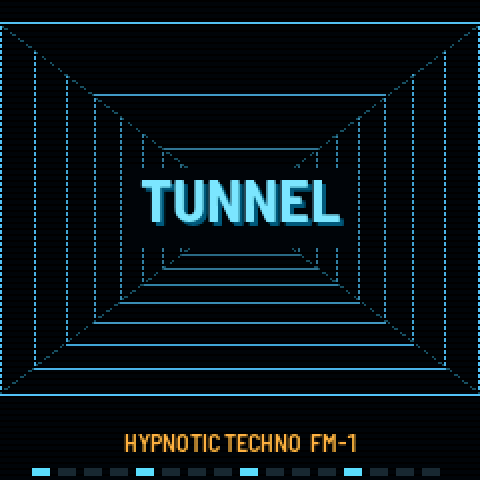

# TUNNEL FM-1

A hard, hypnotic Detroit techno machine for the M-VAVE FM-1, built on
[fm1-base](https://github.com/charlesvestal/fm1-base) (commit `2bb8e74`). Unofficial: not affiliated with or endorsed
by M-VAVE. Every sound is synthesized in the firmware (no samples), and every preset is made by this repository's
generator from its own recipes; none is copied from a record or another instrument.

**Status: 0.2, pre-release.** It builds for the FM-1 and passes fm1-base's host simulator checks. It has not yet been
tested on a real FM-1: install it at your own risk, after a backup.

## The idea

Stripped-back, driving loops that lock you in: a kick that never lets go, hats and a ride carrying the groove, short
minor stabs and bells looping at lengths that don't fit the bar (7 against 16, 5 against 9), so the pattern keeps
turning over itself. Three decks borrow the three-turntable trick: drums from one preset, bass and stabs from a
second, bells from a third, each switching on the bar. TUNNEL, on the ALGORITHM knob, closes the filter and lets the
delay and reverb swell, for the long build into the dark.

## The tracks

| Track | Sound | Its parameters |
| --- | --- | --- |
| KICK | a sine swept down from above its pitch, a click, drive, a low tail | TUNE DECAY PUNCH SWEEP / CLICK DRIVE LOW CUT TAIL |
| SNARE | snare (two tones and bright noise), clap (three bursts and a tail) or rim | MODE TUNE DECAY NOISE / SNAP TONE DRIVE |
| CL HAT | six square oscillators at metallic ratios, band-passed; chokes the open hat | TUNE DECAY TONE METAL / NOISE |
| OP HAT | the same metal, longer; or a ride, with a bell | MODE TUNE DECAY TONE / METAL BELL |
| PERC | tom, conga, rim, cowbell, blip or sine; a step's note tunes it | MODE TUNE DECAY BEND / TONE DRIVE |
| BASS | saw, square, both, sine or sine and saw, with a sine sub; a resonant four-pole ladder, accent, slide | WAVE CUTOFF RES ENV / DECAY ACCENT DRIVE GLIDE |
| STAB | a chord of four notes (minor, minor 7, minor 9, sus 4, fifths, major 7, alien, octaves), two detuned saws (or pulses, soft triangles, or sines with an octave: an organ) each | CHORD CUTOFF RES ENV / DECAY DETUNE WAVE OCTAVE |
| BELL | four voices: FM (a sine on a sine) or a pluck (a dark triangle and a bright one an octave up), with a warble | MODE RATIO TONE DECAY / CUTOFF WARBLE OCTAVE SPREAD |
| SYNTH | four voices in the manner of a mid-80s one-oscillator polysynth: saw, pulse, a swept pulse (PWM), a swept saw (the "hoover", which also scoops up into each note), saw or square with a square sub, sines, or sine and saw; a resonant 24 dB low-pass with half key tracking, one ADSR for the filter and the amp, a stereo chorus. A step holds its note until the next step that plays | WAVE CUTOFF RES ENV / ATTACK DECAY SUSTAIN CHORUS |

Each track has a LEVEL, a PAN, and sends to the DELAY (ping-pong, synced: 1/32 to 1/2, dotted and triplet) and the
REVERB. The master has the SWEEP (a DJ filter: low-pass one way, high-pass the other), a COMP (a bus compressor: one
knob lowers its threshold and raises its ratio together, with half the gain made up), DRIVE and VOLUME. DUCK is the
kick's sidechain: each kick (not the soft ghost hits) pulls down the bass, stab, bell, synth and the delay and reverb
returns, by DUCK, and lets them back over DUCK REL (a sixteenth to half a bar, at the tempo); the drums are never
ducked. The motion LFO, synced to the bar, moves the bass, stab, bell or synth cutoff (or all four), the sweep, or the
hats' tone.

## The sequencer

- Each track: a LENGTH of 1 to 32 steps and a RATE (1/16, 1/8, 1/32, 1/16 triplet). Each keeps its own count, so
  loops of different lengths roll against each other and line up again only every few bars.
- Each step: on, VELOCITY (soft, normal, accent, hard), NOTE (from the track's ROOT and the preset's KEY), RATCHET
  (1 to 4 hits), CHANCE (100, 75, 50, 25 %), and for the bass, SLIDE.
- SWING (straight to 75 %), ROTATE (shift a loop a step, live), mutes on the keys.
- The clock: internal, MIDI, or AUTO (MIDI when it comes); MIDI clock and start / stop out.

## The decks

GLO's second page. DECK A is the drums (kick, snare, hats, percussion), DECK B the bass and the stab, DECK C the bell and
the synth.
Turn a deck's knob to any preset, and that deck's tracks come from it on the next bar (the name shows amber while it
waits). PRESETS changes the whole machine, also on the bar.

## The controls

| Control | Does |
| --- | --- |
| PLAY | start / stop |
| PRESETS | the preset, 000 to 127, then the user presets U01 to U32 |
| SELECT, SEL | the track |
| ALGORITHM | TUNNEL, 0 to 127 (and CC 1 in) |
| HOME | the loops: every track's steps and playhead, its level; K1..K4 SWEEP, FEEDBACK, BPM, DRIVE. The white keys F3..G4 mute the nine tracks, the black keys F#3..C#5 select one (on every page but SEQ, and while REC is off) |
| SEQ | the selected track's steps on the 16 white keys (OCT- / OCT+: 1-16 / 17-32); K1..K4 LENGTH, RATE, ROTATE, ROOT. Hold a step: K1..K4 NOTE, VELOCITY, RATCHET, CHANCE; SEQ while holding it: slide |
| EDIT | the track's sound, two pages |
| ENV | the track's mix: LEVEL, PAN, DELAY, REVERB |
| FX | DELAY (TIME, FEEDBACK, TONE) > REVERB (SIZE, DAMP) > MASTER (SWEEP, DRIVE, VOLUME, COMP) > DYNAMICS (COMP, DUCK, DUCK REL) |
| LFO | RATE, DEPTH, DEST, SHAPE |
| GLO | TEMPO (BPM, SWING, KEY, CLOCK) > DECKS > SETUP (CLOCK OUT, MIDI CH, DRUM CH) |
| REC | the keys play the selected track (chromatic for bass, stab and bell); held a second: Bluetooth on / off |
| ARP | with REC: the keys held are arpeggiated, a sixteenth each, locked to the loops |
| OCT- / OCT+ | the steps' page on SEQ; the keys' octave with REC |
| SAVE | the preset into a user slot: the one playing, or the first free one |

## MIDI

In (USB, Bluetooth, TRS) and out (USB, Bluetooth):

- Drums in on DRUM CH (10): 36 kick, 38/39/40 snare and clap, 42/44 closed hat, 46/49/51 open hat and ride, other
  notes from 41 to 70 percussion (tuned by the note).
- Notes in on MIDI CH (omni by default) play the selected track; CC 1 is TUNNEL; program change picks the preset.
- MIDI clock, Start, Stop and Continue in; clock, Start and Stop out (CLOCK OUT).

## The presets

128 presets in eleven styles (PRESETS.md lists them, with their tempos and the loop lengths that roll):
hard tools, hypnotic loops, stab grooves, ride grooves, bell polymeters, acid and slides, sci-fi, broken and toms,
warehouse, dub and deep, and synth (hoover riffs, brass stabs, swept-pulse pads, plucks and sine leads). Every
preset has its own COMP and DUCK. `tools/gen_presets.py` writes them from a recipe for each style and a seed for each name;
`tools/level_match.py` renders every one (host/render.c) and sets its VOLUME so the bank plays at one loudness.

## Layout

    app/tun.c, tun.h      the engine: voices, sequencer, decks, effects (pure C, float; runs on the FM-1 and a computer)
    app/app.c, app.h      the FM-1 app: pages, keys, presets, MIDI, the screen, the boot screen
    app/factory.h         the presets (from tools/gen_presets.py)
    app/fm1.toml          build settings
    app/tests/            host simulator checks (basic.txt, features.txt)
    app/site/             the site's front page and the player (play.html)
    host/render.c         a preset to a WAV without the app, for listening and level matching
    tools/                gen_presets.py, level_match.py, make_pages.sh

## Building

With [fm1-base](https://github.com/charlesvestal/fm1-base) at commit `2bb8e74` checked out beside this repository and
its toolchain set up (fm1-base's README: `tools/setup_toolchain.sh`; Docker on a Mac). From the folder that holds both
`fm1-base/` and `tunnel-fm1/`:

    sh tunnel-fm1/build.sh host     # the host simulator and its checks
    sh tunnel-fm1/build.sh          # the firmware: tunnel-fm1/app/build/tunnelfm1.fwsc

A release: `python3 fm1-base/tools/build.py tunnel-fm1/app --release X.Y` (identity FM-1_63 and XXYYZZ), then
`sh tunnel-fm1/tools/make_pages.sh X.Y` for the site (front page, installer, player).

## Installing and playing

- [Play it in your browser](https://fergroan-sketch.github.io/tunnel-fm1/play/), on fm1-emu: no FM-1 needed.
- The `.fwsc` is attached to each [release](https://github.com/fergroan-sketch/tunnel-fm1/releases). Install it with
  the [web installer](https://fergroan-sketch.github.io/tunnel-fm1/install/) (Chrome or Edge, USB) or fm1-base's
  `tools/fm1_install.py`. Back up first: installing replaces the firmware that is there and what it saved. The
  installer can put M-VAVE's own firmware back.
