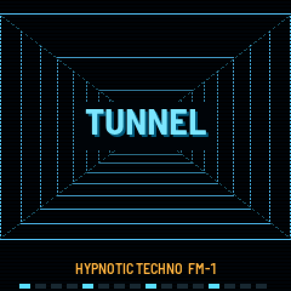
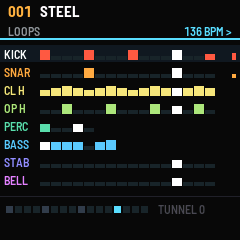
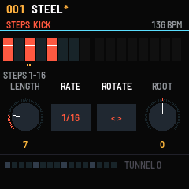

# TUNNEL FM-1

TUNNEL FM-1 is a hard, hypnotic Detroit techno machine for the M-VAVE FM-1. Eight synthesized tracks (a 909-style
kick, snare and clap, closed and open hats and a ride, percussion, a slide bass, chord stabs and bells) each loop at
their own length and rate, so a 7-step stab rolls against a 16-step groove. Three decks cut between presets on the
bar, a ping-pong delay and a reverb open up the space, a DJ filter sweeps, and the TUNNEL macro closes it all in.

This is version {{VERSION}}. You install it at your own risk, and the installer can put M-VAVE's own firmware back.

- [Play it in your browser](play/): the real firmware on an emulated FM-1, no FM-1 needed.
- [Install](install/) it from Chrome or Edge, with the FM-1 connected by USB.
- [Download {{PKG}}](firmware/{{PKG}}) to use the command-line installer: `python3 tools/fm1_install.py {{PKG}}`.
- The source is under MPL-2.0. It's built on fm1-base and felucca-bsp, which come from Felucca by Leo Kuroshita,
  Hügelton Instruments.

M-VAVE and FM-1 are trademarks of their owner. TUNNEL FM-1 is unofficial and not affiliated with M-VAVE.
